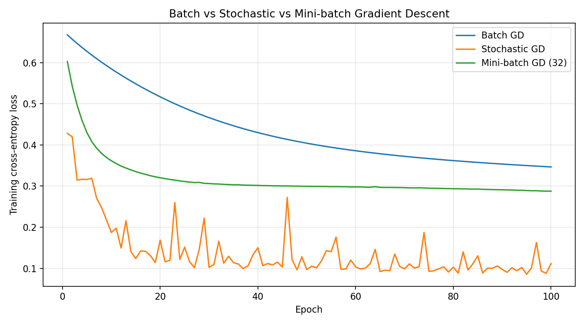
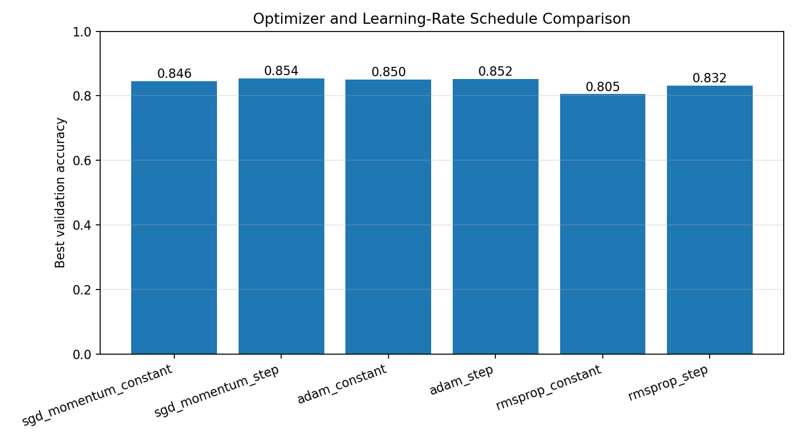
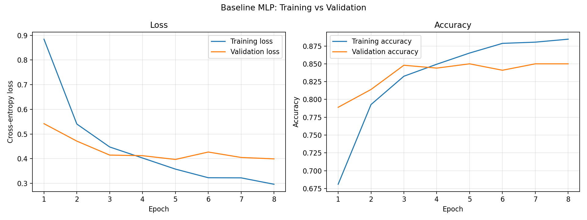
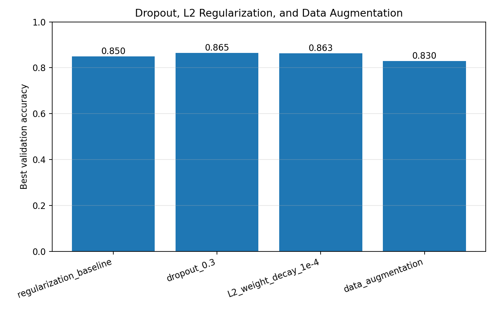
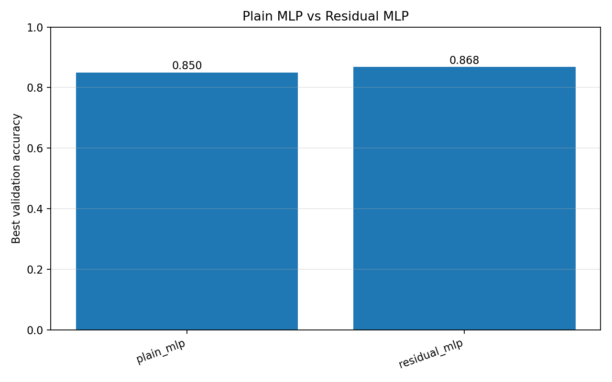

# Deep Learning Lab — Self Learning | Lab Program 1

**Student:** Naman Kumar Agrawal  
**USN:** 1BF24AI115  
**Course:** Deep Learning Lab  
**Repository:** [Deep-Learning-Lab_1BF24AI115](https://github.com/namankrag/Deep-Learning-Lab_1BF24AI115)

This program explores optimization, training behaviour, regularization, and neural-network architecture choices using PyTorch. It combines a small two-dimensional classification example with experiments on the Fashion-MNIST image dataset.

## Aim

To implement and compare gradient-descent variants, optimizers, learning-rate schedules, regularization techniques, early stopping, and plain versus residual multilayer perceptrons (MLPs), and to evaluate their performance using training, validation, and test results.

## Concepts Covered

- **Gradient descent:** Batch, stochastic, and mini-batch gradient descent.
- **Optimization algorithms:** SGD with momentum, Adam, and RMSprop.
- **Learning-rate scheduling:** Constant learning rate and StepLR.
- **Overfitting and generalization:** Training-versus-validation curves.
- **Regularization:** Dropout, L2 regularization (weight decay), and data augmentation.
- **Early stopping:** Monitor validation loss, retain the best model weights, and stop when validation performance stops improving.
- **Network architecture:** Compare a plain MLP with an MLP containing a residual/skip connection.
- **Model evaluation:** Cross-entropy loss and classification accuracy.

## Repository Contents

```text
SELF LEARNING _ LAB PROGRAM_1/
├── README.md
├── SELF LEARNING _ LAB PROGRAM_1.py
├── fashion_mnist_results.csv
├── baseline_overfitting_curves.png
├── gradient_descent_comparison.png
├── optimizer_and_schedule_comparison.png
├── plain_vs_residual_mlp.png
├── regularization_comparison.png
└── .gitkeep
```

The CSV contains the Fashion-MNIST experiment metrics. The PNG files are the plots generated for the experiments and included in this folder.

## Dataset

The image-classification experiments use **Fashion-MNIST**, a dataset of grayscale clothing images with 10 classes. The script downloads the dataset automatically the first time it runs; a separate dataset file does not need to be added to the repository.

For the experiments, the script selects fixed subsets:

| Split | Number of images |
|---|---:|
| Training | 7,000 |
| Validation | 1,000 |
| Testing | 2,000 |

Images are converted to tensors and normalized using mean `0.2860` and standard deviation `0.3530`. The data-augmentation experiment applies small random rotations, translations, and scale changes to training images.

A separate two-class dataset generated with scikit-learn's `make_moons` is used to demonstrate the three gradient-descent variants.

## Requirements

- Python **3.10 or later**
- PyTorch
- torchvision
- NumPy
- Matplotlib
- scikit-learn

Install the required packages:

```bash
pip install torch torchvision numpy matplotlib scikit-learn
```

## How to Run

1. Clone the repository:

   ```bash
   git clone https://github.com/namankrag/Deep-Learning-Lab_1BF24AI115.git
   ```

2. Move into the program folder:

   ```bash
   cd "Deep-Learning-Lab_1BF24AI115/SELF LEARNING _ LAB PROGRAM_1"
   ```

3. Run the Python program:

   ```bash
   python "SELF LEARNING _ LAB PROGRAM_1.py"
   ```

The program automatically selects CUDA when a compatible GPU is available; otherwise, it runs on the CPU. Fashion-MNIST is downloaded into the `data/` directory. Newly generated result files are written to `lab1_outputs/`.

## Approach and Experiments

### 1. Batch, Stochastic, and Mini-batch Gradient Descent

A small MLP is trained on a two-dimensional `make_moons` classification dataset. The following update strategies are compared:

- **Batch GD:** Uses the complete training subset for each parameter update.
- **Stochastic GD:** Uses one training example for each update.
- **Mini-batch GD:** Uses batches of 32 examples.

Training loss is plotted across epochs, and test accuracy is calculated for each method.

### 2. Optimizers and Learning-Rate Schedules

A Fashion-MNIST MLP is trained using:

- SGD with momentum (learning rate 0.05)
- Adam (learning rate 0.001)
- RMSprop (learning rate 0.001)

Each optimizer is evaluated with both a constant learning rate and a StepLR schedule.

### 3. Overfitting and Regularization

A baseline MLP is compared with three regularization configurations:

- **Dropout:** Dropout probability of 0.3.
- **L2 regularization:** Weight decay of 0.0001.
- **Data augmentation:** Random affine transformations applied to training images.

The baseline training and validation curves help illustrate the difference between fitting the training data and generalizing to unseen data.

### 4. Early Stopping

During training, validation loss is monitored. The best-performing model weights are saved and restored at the end of training. Training stops when validation loss has not improved for the configured patience of 3 epochs.

### 5. Plain MLP vs Residual MLP

The program compares a plain fully connected MLP with a residual MLP that uses a skip connection. Both are evaluated on the same Fashion-MNIST subsets and training setup.

## Results

The following values are from the committed `fashion_mnist_results.csv`. Accuracy is shown as a percentage. The test set in this experiment contains 2,000 selected Fashion-MNIST images.

| Experiment | Best epoch | Validation accuracy | Test accuracy | Test loss | Early stopped |
|---|---:|---:|---:|---:|:---:|
| SGD momentum — constant | 8 | 84.60% | 83.80% | 0.4841 | No |
| SGD momentum — StepLR | 7 | 85.40% | 84.25% | 0.4264 | No |
| Adam — constant | 5 | 85.00% | 85.15% | 0.4221 | Yes |
| Adam — StepLR | 7 | 85.20% | 84.25% | 0.4209 | No |
| RMSprop — constant | 5 | 80.50% | 82.40% | 0.5381 | Yes |
| RMSprop — StepLR | 7 | 83.20% | 83.15% | 0.4833 | No |
| Regularization baseline | 5 | 85.00% | 85.15% | 0.4221 | Yes |
| Dropout (0.3) | 12 | 86.50% | 84.20% | 0.4493 | No |
| L2 weight decay (0.0001) | 9 | 86.30% | 84.60% | 0.4448 | Yes |
| Data augmentation | 11 | 83.00% | 80.60% | 0.5233 | No |
| Plain MLP | 5 | 85.00% | 85.15% | 0.4221 | Yes |
| Residual MLP | 9 | **86.80%** | **85.35%** | 0.4396 | Yes |

**Best result in this run:** The residual MLP achieved the highest validation accuracy (86.80%) and test accuracy (85.35%) among the listed Fashion-MNIST experiments. These values reflect the selected subsets and configuration used in this program; results may vary with different environments or settings.

## Output Plots

### Gradient-descent comparison

Compares the training-loss curves for batch, stochastic, and mini-batch gradient descent.



### Optimizers and learning-rate schedules

Compares validation accuracy for SGD with momentum, Adam, and RMSprop using constant and StepLR schedules.



### Overfitting behaviour

Shows the baseline model's training and validation loss and accuracy curves.



### Regularization comparison

Compares the baseline, dropout, L2 weight decay, and data-augmentation experiments.



### Plain MLP vs residual MLP

Compares the validation accuracy of the plain and residual network architectures.



## Conclusion

This program demonstrates how optimization choices, learning-rate schedules, regularization methods, early stopping, and network architecture affect neural-network training and generalization. In the recorded Fashion-MNIST run, the residual MLP produced the strongest validation and test accuracy among the compared configurations. The experiments also show why training and validation behaviour should be examined alongside test metrics when evaluating a model.

## References

- [Fashion-MNIST dataset](https://github.com/zalandoresearch/fashion-mnist)
- [PyTorch documentation](https://pytorch.org/docs/stable/index.html)
- [torchvision datasets documentation](https://pytorch.org/vision/stable/datasets.html)
- [scikit-learn documentation](https://scikit-learn.org/stable/)

---

*Submitted as part of the Deep Learning Lab coursework (1BF24AI115).*
